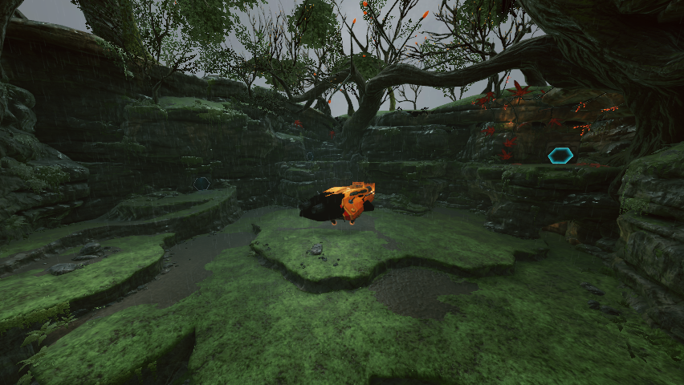
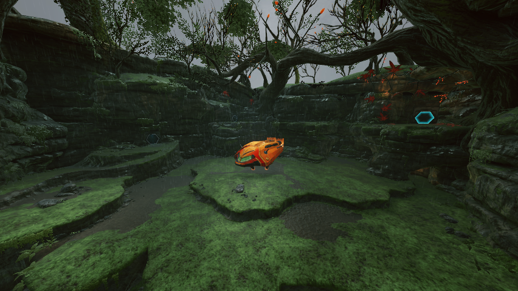

# Landing Site gunship scenery comparison

Candidate: `b42b4d45e930cdf3e9800f645c8b24529b16a9d5` on upstream `7b01cdf8a4fd5d2e33396e2caaa28917d22a95f4`.
The importer file was also checked unchanged at upstream `cbca5084b9f48cfbb5a703f252a0272e1775bf64`.

## Problem and scope

Landing Site (`B2701146`) contains four added static actors using source model `A4DE141BEA3B44AD812346E45C649B06` and one using `F318ACF83D2B461B8AF7A66E61DBB4D0`. These cinematic hulls have no imported pose or supported animation binding. Their nonzero source placements bypass the generic room-origin cinematic guard and overlap the original animated ship.

The fix excludes only these added, unbound static source actors in this room. Platforms, synthetic replacements, animation properties and supported transform bindings remain eligible. It preserves the original animated ship, hatch/platform, collision and save sequence; it does not add an animated Remastered replacement. Existing imports need a re-import because the room stage version changes from 44 to 45.

## Source verification

A targeted probe called the actual production `Writer::WriteGeometry` and retail-model pairing against the owned source ROOM and retail MREA/SCLY data. Baseline output has 645 instances; candidate has 640. Removing exactly the four hull and one unlit-hull records from baseline yields byte-identical candidate output, including remaining instance and script bytes. HIDE indices remain valid and original ship objects are not hidden.

Both affected source models were separately converted successfully using the production converter and real decoded source textures (10 decoded textures, 18 output files, four PBR materials). A 1024-pixel texture limit was used for this fixture. Generated game assets are not included here.

## Runtime comparison and limits

This is a controlled minimal source-placement fixture, **not a full fresh world import**. The production-writer comparison above is independent of the runtime fixture. A working imported Landing Site descriptor with 4130 instances was used in both runtime contexts. For baseline, the five actual source-generated actor records were appended, producing 4135 instances without changing existing hiding indices. Candidate uses the original 4130-instance descriptor byte for byte. Both runs expose the same successfully converted source models and textures.

The arrival sequence was stepped through nine relative tick positions, followed by a fixed parked view and a diagnostic warp out/back. Both runs reach normal first-person gameplay and exit successfully. These are separate process starts, not a pixel-identical camera/time benchmark. The revisit is a diagnostic warp, not a manual door traversal.

Baseline draws an added hull alongside the original ship at five of the eleven captured states. Candidate submits zero draws for either added hull in all eleven states, while retaining the original ship's five draws whenever it is visible. The baseline story script already hides the added hull on the revisit. The parked pair below shows the black overlapping bow removed.

Both active save-function objects and their connections remain present. Saving itself was not exercised. No GPU validation or fatal errors were reported. Baseline recorded 24 transient first-use skipped shader draws; candidate recorded zero. Neither had pending pipelines at the end. No installed app, normal saves/settings, or live imported assets were changed.

## Build and automated checks

Native Apple M1 Max / Metal build with Apple Clang 21. Both baseline and candidate use the same explicitly overridden Dawn SDK v20261025.182847.

- Three focused tests pass: gunship source policy, room geometry, and Remastered room scripts. The standalone policy test also passes with `-Wall -Wextra -Werror`.
- Full serial CTest: 630 passed, one skipped, one failed out of 632. `SceneHdrTest.GxWriterVariantsCompileInBothModes` aborts with `std::out_of_range` (`basic_string`), reproduced on the unchanged tested upstream base. `port_entity_schema_current` skips because its optional source is absent.

`validation.json` contains per-capture draw counts. `fixture.json` records the controlled-fixture method and descriptor hashes. `writer-comparison.log` contains the production-writer assertion result. End-to-end import-cache orchestration and the save dialog were not tested.
